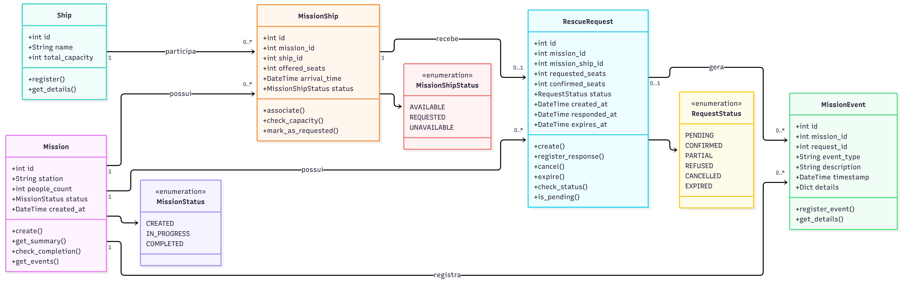
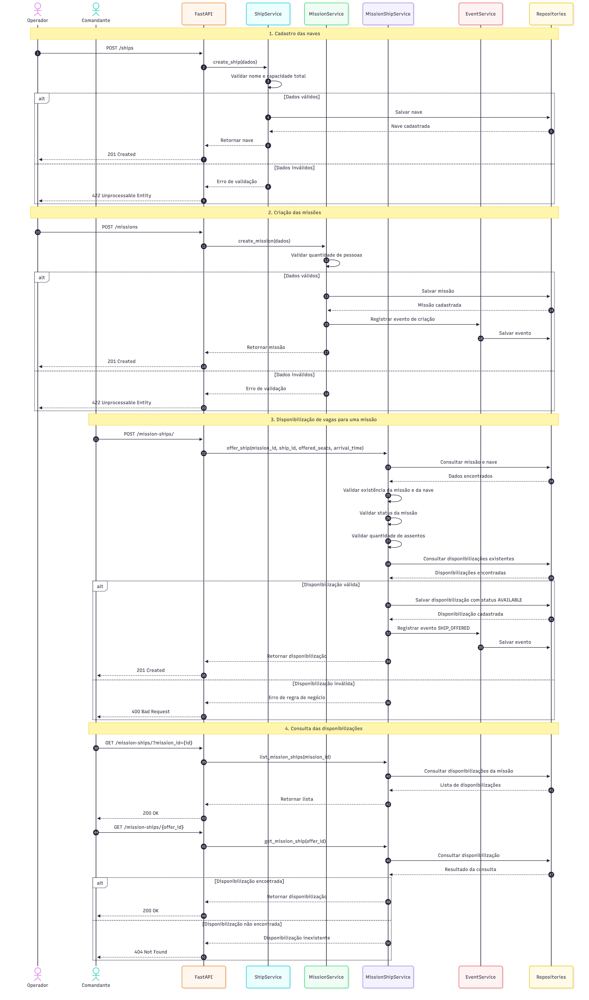
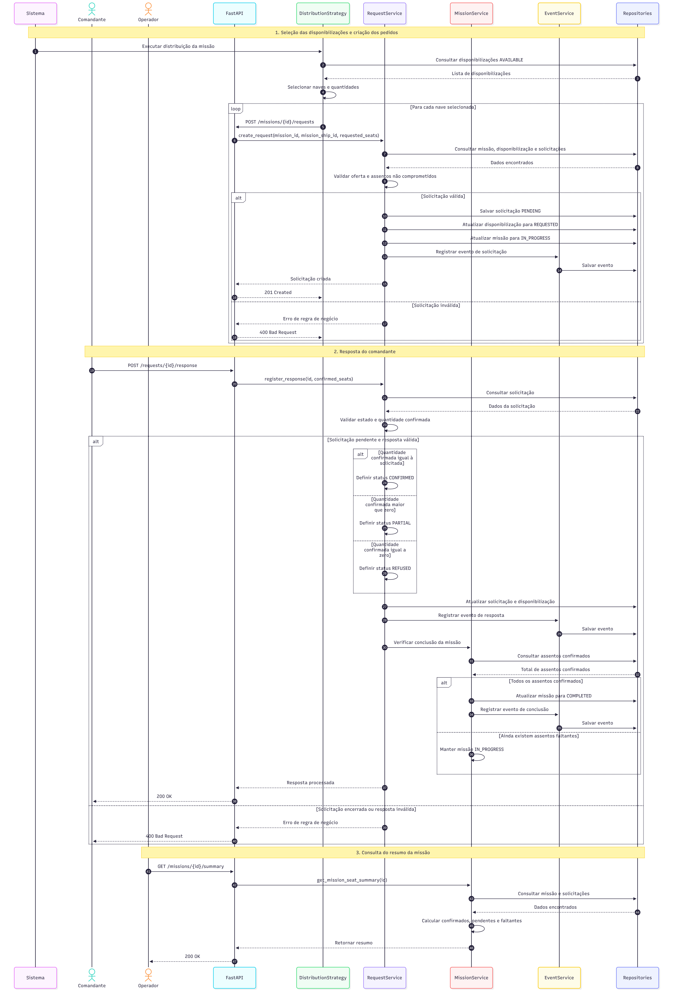

# Operação Resgate Espacial

## Arquitetura do Sistema

### Estrutura de Classes

### Diagramas de Sequência

#### Cadastro de naves e preparação da missão

#### Solicitação e resposta dos comandantes

#### Cancelamento e expiração de missões

### APIs Implementadas

| Método HTTP | Endpoint | Descrição |
| ----------- | -------- | --------- |
| POST | /missions | Cadastrar uma missão |
| GET | /missions | Listar todas as missões |
| GET | /missions/{mission_id} | Consultar uma missão específica |
| GET | /missions/{mission_id}/summary | Consultar o resumo da situação do resgate |
| GET | /missions/{mission_id}/events | Consultar o histórico de eventos da missão |
| POST | /ships	| Cadastrar uma nave no sistema |
| GET | /ships	| Listar todas as naves cadastradas |
| GET | /ships/{ship_id} | Consultar uma nave específica |
| POST | /missions/{mission_id}/ships | Disponibilizar uma nave para uma missão |
| GET | /missions/{mission_id}/ships | Listar as naves disponibilizadas à missão |
| GET | /missions/{mission_id}/ships/{ship_id} | Consultar a disponibilidade de uma nave na missão |
| PATCH | /missions/{mission_id}/ships/{ship_id} | Atualizar a disponibilidade oferecida para a missão |
| POST | /missions/{mission_id}/requests | Criar pedido de reserva |
| GET | /missions/{mission_id}/requests | Listar pedidos da missão |
| GET | /requests/{request_id} | Consultar pedido específico |
| POST | /requests/{request_id}/response | Registrar resposta da nave |
| POST | /requests/{request_id}/cancel | Cancelar pedido pendente |
| POST | /requests/{request_id}/expire | Expirar pedido pendente |
| GET | /missions/{mission_id}/summary | Consultar situação consolidada da missão |
| GET | /missions/{mission_id}/events | Consultar eventos registrados |

### Decisões Técnicas
 
| Assunto | Decisão inicial |
| ------- | --------------- |
| Linguagem | Python |
| Framework | FastAPI |
| Documentação | Swagger UI automático |
| Persistência | Em memória |
| Validação de dados | Pydantic |
| Testes | pytest e TestClient |
| Concorrência | Locks por missão |
| Comunicação com comandantes | Simulada por endpoints |
| Expiração | Simulada por operação da API |
| Histórico | Eventos imutáveis |
